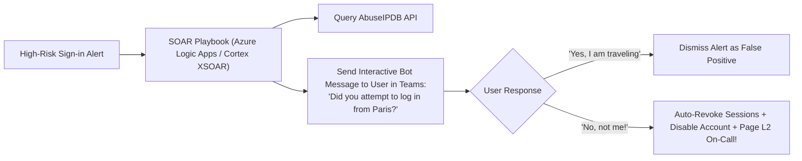

# 03. SOAR Automation Playbooks and Orchestration

[⬅️ Prev: Detection Engineering](./02_Detection_Engineering_and_Sigma_Rules.md) | [Back to Advanced Topics](./README.md) | [Next: Interview Preparation Track ➡️](../09_Interview_Preparation/README.md)

---

### 1. Why SOAR is Critical
Tier 1 analysts spend 60% of their day performing repetitive tasks: querying VirusTotal for a hash, checking IP reputation, or pinging a user on Teams to ask *"Did you just log in from Germany?"*

**SOAR (Security Orchestration, Automation, and Response)** automates these repetitive workflows:

