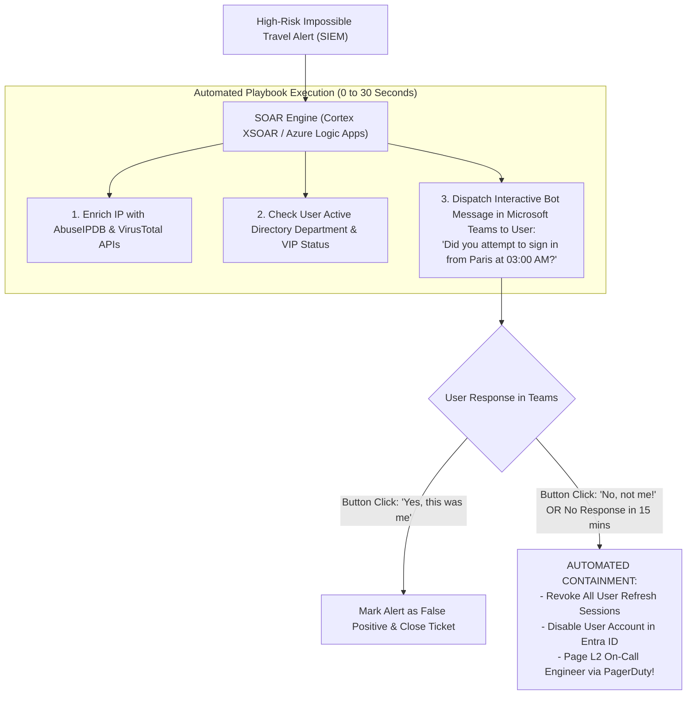

# 03. SOAR Automation Playbooks and Orchestration Deep Dive

[⬅️ Prev: Detection Engineering](./02_Detection_Engineering_and_Sigma_Rules.md) | [Back to Advanced Topics](./README.md) | [Next: DFIR ➡️](./04_Digital_Forensics_Incident_Response_DFIR.md)

---

### 1. Platform Overview & Architecture

**SOAR (Security Orchestration, Automation, and Response)** unifies disparate security tools into automated runbooks (Playbooks). It eliminates manual, repetitive triage tasks, allowing human analysts to focus on complex investigation.



---

### 2. Azure Logic App Playbook Definition (JSON Workflow)

In Microsoft Sentinel, SOAR playbooks are deployed as Azure Logic Apps:

```json
{
  "definition": {
    "$schema": "https://schema.management.azure.com/providers/Microsoft.Logic/schemas/2016-06-01/workflowdefinition.json#",
    "actions": {
      "Revoke_User_Sessions": {
        "type": "Http",
        "inputs": {
          "method": "POST",
          "uri": "https://graph.microsoft.com/v1.0/users/@{triggerBody()?['UserPrincipalName']}/revokeSignInSessions",
          "authentication": {
            "type": "ManagedIdentity"
          }
        }
      },
      "Send_Teams_Notification": {
        "type": "ApiConnection",
        "inputs": {
          "host": {
            "connection": {
              "name": "teams-connection"
            }
          },
          "method": "post",
          "path": "/v3/beta/teams/channel/messages",
          "body": {
            "body": {
              "content": "🚨 High-Risk Account Compromise Auto-Contained for user @{triggerBody()?['UserPrincipalName']}!"
            }
          }
        }
      }
    }
  }
}
```
