# Security Operations Center (SOC) Career Path & Knowledge Base

Welcome to the **Security Operations Center (SOC)** practitioner's curriculum. This track trains you in real-time threat detection, alert triage, log forensics, incident containment, and cyber threat hunting.

---

## 📌 Track Overview

The Security Operations Center is the command center of corporate defense. SOC analysts stand as the active watchtowers of an enterprise, analyzing telemetry from tens of thousands of endpoints, cloud servers, and network devices to stop active adversaries before data is exfiltrated or ransomware is deployed.

```mermaid
graph LR
    LogSources["Log Sources & Telemetry<br>(Endpoints, Firewalls, Cloud, Identity)"] --> Collector["Log Forwarders & Syslog Agents"]
    Collector --> SIEM["SIEM / Data Lake<br>(Microsoft Sentinel / Splunk)"]
    SIEM --> Analytics["Detection Engine & Correlation Rules"]
    Analytics --> Alert["Security Alert Generated"]
    Alert --> L1["SOC Tier 1 Analyst<br>(Initial Triage & Validation)"]
    L1 -->|True Positive Escalation| L2["SOC Tier 2 / IR Responder<br>(Deep Forensics & Containment)"]
    L2 -->|Complex Breach / APT| L3["SOC Tier 3 / Threat Hunter<br>(Root Cause & Campaign Eradication)"]
```

---

## 🗺️ Chronological Learning Sequence

| Folder | Focus Area | Description |
| :--- | :--- | :--- |
| **[01_Fundamentals](./01_Fundamentals/README.md)** | Baseline Foundations | SOC structure, Analyst tiers (L1/L2/L3), TCP/IP networking, and OS internals. |
| **[02_Core_Concepts](./02_Core_Concepts/README.md)** | Operational Theory | Telemetry types, Event logs, Cyber Kill Chain, MITRE ATT&CK, Threat Intel & IOCs. |
| **[03_Technologies_and_Architectures](./03_Technologies_and_Architectures/README.md)** | Defensive Technologies | SIEM pipelines, EDR/XDR mechanics, Firewalls/IDS/IPS, Email security, Malware triage. |
| **[04_Tools_and_Platforms](./04_Tools_and_Platforms/README.md)** | Core SOC Tooling | Microsoft Sentinel (KQL), Splunk (SPL), CrowdStrike Falcon, Wireshark, OSINT tools. |
| **[05_Workflows_and_Processes](./05_Workflows_and_Processes/README.md)** | Enterprise SOPs | 8-point operational workflows for Alert Triage, Investigation, Containment, and Escalation. |
| **[06_Real_World_Scenarios](./06_Real_World_Scenarios/README.md)** | Realistic Breaches | Phishing payloads, Impossible Travel, Ransomware containment, Pass-the-Hash, DNS beacons. |
| **[07_Hands_On_Labs](./07_Hands_On_Labs/README.md)** | Practical Skills | KQL threat hunting, Splunk search crafting, Wireshark PCAP triage, Email header analysis. |
| **[08_Advanced_Topics](./08_Advanced_Topics/README.md)** | Elite Capabilities | Proactive threat hunting, Detection Engineering (Sigma rules), SOAR playbooks. |
| **[09_Interview_Preparation](./09_Interview_Preparation/README.md)** | Career Launchpad | Technical questioning, alert triage walk-throughs, and hiring manager expectations. |
